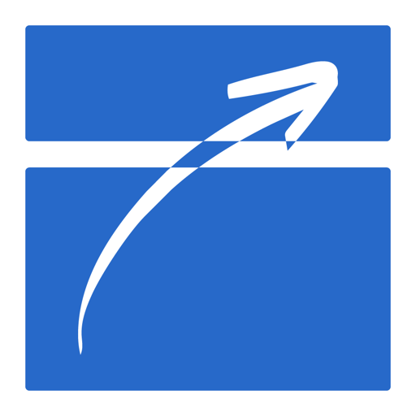

# SplitZone

Mac 화면을 원하는 구역으로 나누고, 창을 끌어다 놓기만 하면 구역에 딱 맞게 배치해 주는 무료 창 관리 앱입니다.

**[⬇ SplitZone 다운로드](https://github.com/blackjaguar43/splitzone/releases/latest/download/SplitZone.dmg)** · [소개 페이지](https://blackjaguar43.github.io/splitzone/) · [개인정보 처리방침](https://blackjaguar43.github.io/splitzone/privacy-policy.html)

- macOS 14 Sonoma 이상, Apple 실리콘과 Intel Mac 지원
- Developer ID 서명 및 Apple 공증 완료

## 사용법

1. SplitZone.dmg를 열고 SplitZone을 응용 프로그램 폴더로 옮깁니다.
2. 처음 실행하면 **시스템 설정 → 개인정보 보호 및 보안 → 손쉬운 사용**에서 SplitZone을 켭니다.
3. 창을 Shift를 누른 채 드래그하면 구역이 나타나고, 원하는 구역에 놓으면 배치됩니다.

| 단축키 | 동작 |
| --- | --- |
| Shift + 창 드래그 | 구역 표시, 놓은 구역에 배치 |
| ⌃⌥← / → | 이전·다음 구역으로 이동 |
| ⌃⌥↓ | 원래 크기로 되돌리기 |

## 문의

문제나 제안은 [Issues](https://github.com/blackjaguar43/splitzone/issues)에 남겨 주세요.

© 2026 HAK HYUN LEE. SplitZone은 무료로 배포되며, 소스 코드는 공개하지 않습니다.
